# Where Does Hypergraph Mapping Pay Off?

**Mapping EEG spiking neural networks (seizure detection and motor imagery) onto neuromorphic cores**

Data: CHB-MIT and BCI Competition IV-2a | Stack: PyTorch, MNE, MOABB, Icarus Verilog, Yosys | All hardware results are **simulations**

---

## In one minute

Brain-inspired chips are made of many small cores. When a neuron on one core sends a spike to a neuron on another core, the spike travels over an on-chip network. That costs energy and time. So **which neurons share a core, and where each core sits on the chip, matters.**

This project:

1. Trains small spiking neural networks (SNNs) on two EEG tasks: **seizure detection** and **4-class motor imagery**.
2. Turns each trained network into a **hypergraph**. One neuron sends one spike to many targets, so one hyperedge per sending neuron is a more honest model than many separate edges.
3. Compares a **hypergraph-aware mapping pipeline** against a **naive layer-order pipeline**, scored by the same cost model (energy-latency product, **ELP**, lower is better).
4. Asks the real question: **where does the gain come from, and does it survive more realistic hardware tests?**

> Energy and latency come from a Loihi-based cost model, **not from a physical chip**. Accuracy is only a gate in this work, because mapping never changes accuracy.

---

## The answer (short version)

| Question | Answer |
|---|---|
| Does the full hypergraph-aware pipeline beat the naive one? | **Yes, on all 14 valid models** (5 seizure + 9 motor imagery). ELP is 23 to 73 % lower on seizure models and 28 to 62 % lower on motor-imagery models. |
| Where does the gain come from? | Mostly **traffic-aware placement**. It helps on every model of both tasks. |
| Does hypergraph partitioning add anything on top? | **It depends on the network.** Seizure: only on the large sparse network (+11.0 %). Motor imagery: +15 to +31 % beyond placement, even on dense networks. |
| Does 50 % sparsity lower the cost? | **No.** About 99 % of the (source neuron, destination core) pairs survive, so traffic barely changes. Memory saving is only 0.5 to 5.8 % once index storage is counted. |
| Does the gain survive realistic hardware tests? | **Yes** in trace replay and cycle-level simulation. **No** if all front-end input traffic goes through a single port. |
| Does int8 keep accuracy? | Seizure models: yes (AUC unchanged). Motor-imagery models: **failed our pre-declared gate** (1 of 9 with LN a, 0 of 9 with LN b), though the actual change is small (about -0.4 points on average). |
| Do the mappings fit assumed core limits? | Sparse seizure models fit. **No motor-imagery mapping fits** (18 of 18 partitions break the synapse limit). |

---

## How the pipeline works

<p align="center">
  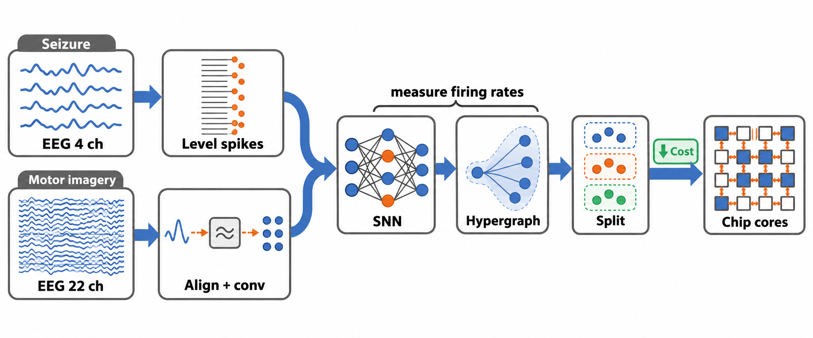<br>
  <em>Fig. 1. Both EEG tasks feed the same steps: train an SNN, measure firing rates, build the hypergraph, split into cores, place cores on the chip grid, estimate cost.</em>
</p>

**Why a hypergraph?** A plain graph counts every connection as a message. A hypergraph counts one message per sending neuron and target core, because the target core copies the spike locally.

<p align="center">
  <br>
  <em>Fig. 2. Graph: 5 messages. Hypergraph: 2 messages.</em>
</p>

**What the mapping does.** Neurons that talk a lot are grouped on the same core, and cores that talk a lot are placed close together.

<p align="center">
  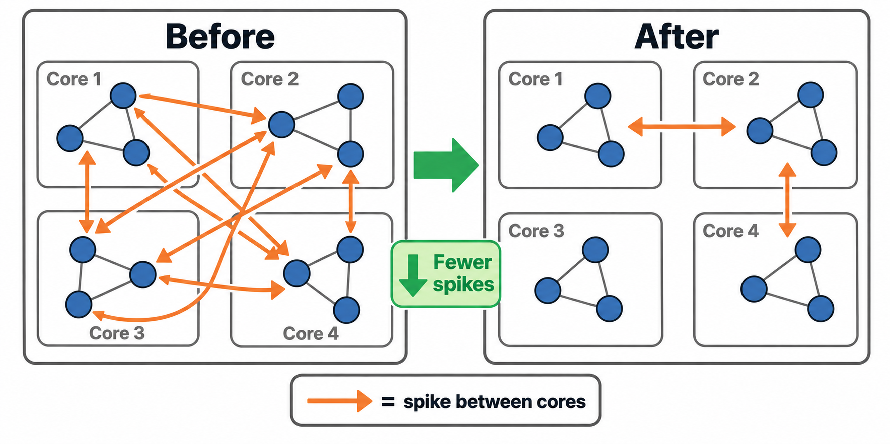<br>
  <em>Fig. 3. The same neurons on four cores before and after mapping. Fewer spikes cross between cores.</em>
</p>

### Cost model

Each spike that travels `d` hops costs `d (E_R + E_T) + E_R` energy and `d (L_R + L_T) + L_R` time, with E_R = 1.7 pJ, E_T = 3.5 pJ, L_R = 2.1 ns, L_T = 5.3 ns (Loihi-based constants from Ronzani and Silvano). Total energy is summed over deliveries weighted by the measured firing rate of the sending neuron. **ELP = energy x average latency.** The same scoring function is used for every method. Cores hold at most 32 neurons.

### Four pipelines (the ablation)

| ID | Partitioning | Placement | Used for |
|---|---|---|---|
| A | naive (layer order) | row by row | the baseline |
| B | naive | Hilbert curve + swap refinement | **B vs A = effect of placement** |
| C | hypergraph overlap | row by row | |
| D | hypergraph overlap | Hilbert curve + swap refinement | **D vs A = full pipeline; D vs B = what partitioning adds beyond placement** |

Each variant is run over 5 placement seeds (42 to 46).

---

## The two tasks and their models

### Task 1: Seizure detection (CHB-MIT)

- Data: patient chb01 only. 4 EEG channels (F7-T7, T7-P7, F8-T8, T8-P8), 256 Hz. Each sample becomes one spike on one of 16 amplitude levels, giving 64 input neurons.
- 8-second windows. Files are split by record, not by window.

| Set | Records | Windows | Seizure windows |
|---|---|---|---|
| Train | 03, 04, 15, 21, 26 | 2090 | 40 |
| Validation | 16 | 450 | 6 |
| Test | 18 | 450 | 11 |

Six models (three sizes, dense and 90 % sparse). **Accuracy gate** (set before looking at any mapping result): not dead, and validation and test AUC both at least 0.95. **Five passed.** `SZ-S_sparse` failed (AUC 0.414 / 0.048) and was left out.

| Model | Layers | Synapses | Cores | Gate |
|---|---|---|---|---|
| SZ-S_dense | 64-8-1 | 520 | 3 | pass |
| SZ-S_sparse | 64-8-1 | 56 | 3 | **fail** |
| SZ-M_dense / SZ-M_sparse | 64-64-16-1 | 5136 / 496 | 5 | pass |
| SZ-L_dense / SZ-L_sparse | 64-128-128-64-32-1 | 34848 / 3488 | 14 | pass |

> AUC 1.0 on 6 and 11 seizure windows shows the models work, not that they generalize. Even a single feature (spread of levels in a window) gives AUC 0.97 to 0.99.

### Task 2: Motor imagery (BCI Competition IV-2a, via MOABB)

- 9 subjects, 22 channels, 4 classes (left hand, right hand, feet, tongue), 5,184 trials, 8-30 Hz, Euclidean Alignment.
- One stratified 80/20 split (4,147 train / 1,037 validation). **No separate test set.** Reference: log-variance + LDA = 44.9 % (chance 25 %).

Nine models: 3 sizes x 3 training modes.

<p align="center">
  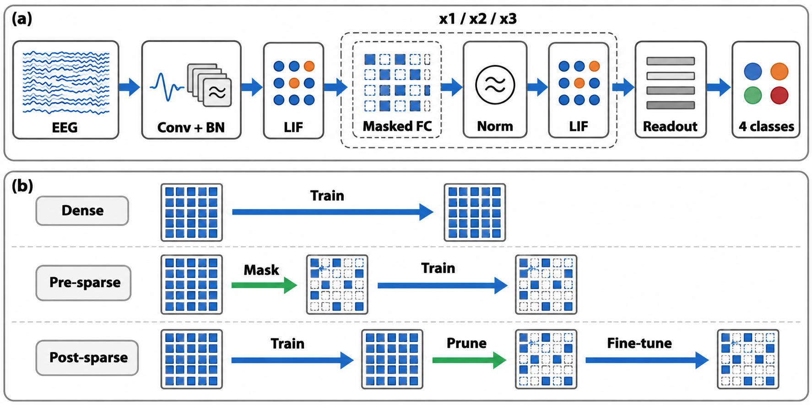<br>
  <em>Fig. 4. (a) Depthwise conv front end, LIF conv units, masked fully connected + LayerNorm + LIF blocks, non-spiking readout. (b) Dense, pre-sparse (mask then train) and post-sparse (train, prune half, fine-tune).</em>
</p>

| Size | Layers | Parameters | Hypergraph nodes | Cores |
|---|---|---|---|---|
| S | 22-44-64-4 | 5,752 | 112 | 4 (2x2) |
| M | 22-88-128-64-4 | 25,324 | 284 | 9 (4x4 grid) |
| L | 22-176-256-128-64-4 | 97,748 | 628 | 20 (8x8) |

All nine passed the gate (50 % validation accuracy). Accuracy (validation, mean of last 10 epochs): S about 56 to 58 %, M about 61 %, L about 62 %. Differences of about 1 point between dense, pre and post are within noise (one seed), so **pre vs post is undecided.**

---

## Results: seizure models

| Model | Cores | D vs A (full pipeline) | B vs A (placement) | D vs B (partitioning) |
|---|---|---|---|---|
| SZ-S_dense | 3 | +31.3 % | +47.7 % | -31.3 % |
| SZ-M_dense | 5 | +73.1 % | +76.3 % | -13.6 % |
| SZ-M_sparse | 5 | +70.0 % | +72.1 % | -7.7 % |
| SZ-L_dense | 14 | +23.4 % | +20.1 % | +4.1 % |
| SZ-L_sparse | 14 | +27.1 % | +18.1 % | **+11.0 %** |

Positive means lower ELP than the reference. 5-seed means.

<p align="center">
  <br>
  <em>Fig. 5. Naive vs hypergraph-aware mapping for the five valid seizure models (single run, seed 42). ELP (log scale), total energy, average latency.</em>
</p>

<p align="center">
  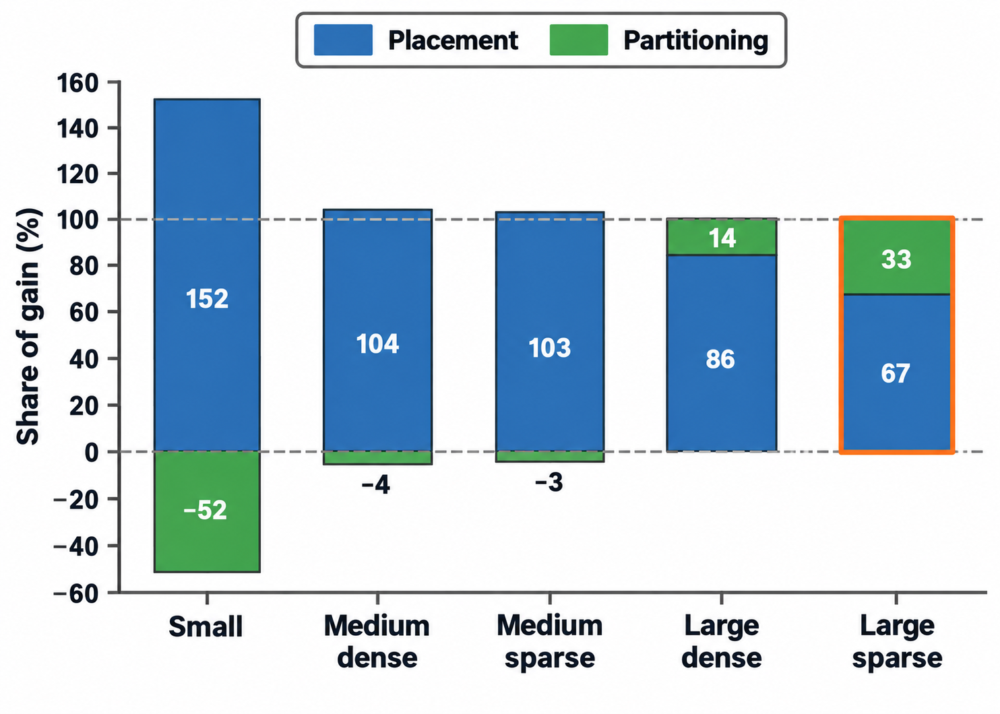<br>
  <em>Fig. 6. Share of the total ELP gain that comes from placement (blue) and from partitioning (green).</em>
</p>

**Reading it simply:** placement does most of the work. Partitioning helps only on the large sparse network, and that result repeated on an earlier independent set of models (+13.7 %, then +11.0 %). In dense layers every neuron talks to every neuron in the next layer, so any grouping looks the same to the partitioner.

---

## Results: motor-imagery models

D vs A is +28 to +31 % (S), +44 to +46 % (M), +58 to +61 % (L), so **the gain grows with network size.**

| Gain (range over dense, pre, post) | S | M | L |
|---|---|---|---|
| D vs A (full pipeline) | +28 to +31 | +44 to +46 | +58 to +61 |
| B vs A (placement only) | 0 | +33 to +35 | +50 to +54 |
| D vs B (partitioning beyond placement) | +28 to +31 | +17 to +18 | +15 to +17 |
| C vs A (partitioning alone) | -29 to -51 | +21 to +31 | +6 to +23 |

B equals A for S because 4 cores leave nothing to improve (the placement search reaches the exhaustive optimum).

<p align="center">
  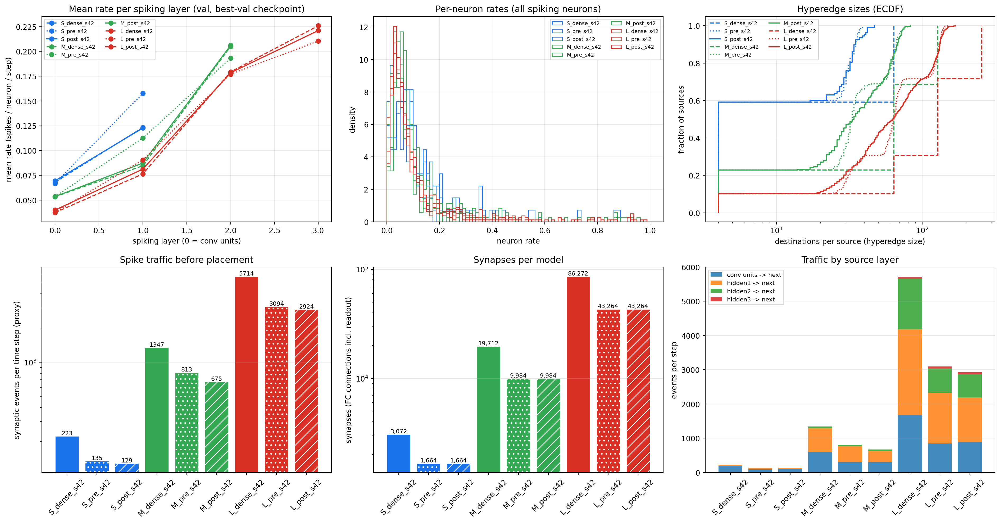<br>
  <em>Fig. 7. Hypergraph extraction for the motor-imagery models: firing rates per layer, per-neuron rates, hyperedge sizes, spike traffic, synapses per model.</em>
</p>

<p align="center">
  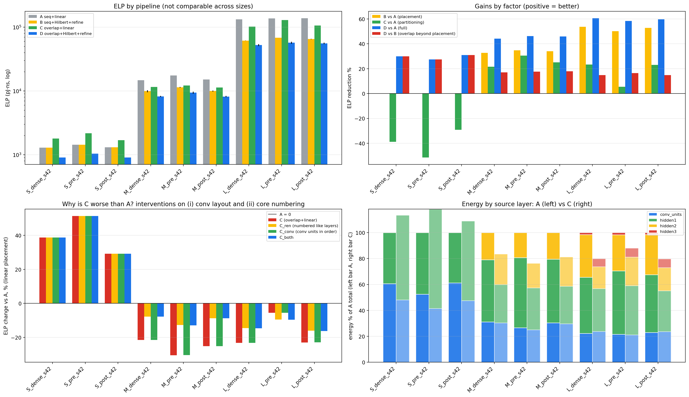<br>
  <em>Fig. 8. Mapping ablation A/B/C/D. (a) ELP. (b) Gain by factor. (c) Two tests of why C is worse than A on S: neither closed the gap. (d) Energy by source layer.</em>
</p>

**Does 50 % sparsity help?** No. Pre-sparse D is 8.7 to 14.7 % *worse* than dense D, and post-sparse D is about equal. The cost counts one message per (source neuron, destination core) pair, and about 99 % of those pairs survive 50 % fan-in sparsity, even though synaptic events per step fall by 40 to 50 %.

<p align="center">
  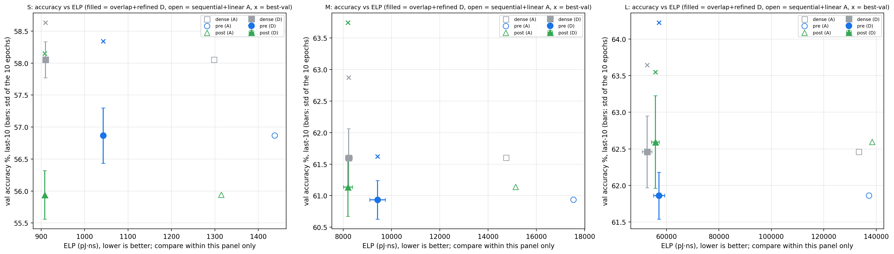<br>
  <em>Fig. 9. Accuracy vs ELP in three panels (S, M, L). Mapping only moves neurons, so accuracy is the same under every mapping. Compare ELP only inside one panel.</em>
</p>

---

## Hardware verification (four levels)

The formulas assume average rates and one cost per hop. So each result is re-checked at four levels, and each level removes one assumption of the level before. They are never called by each other's names.

<p align="center">
  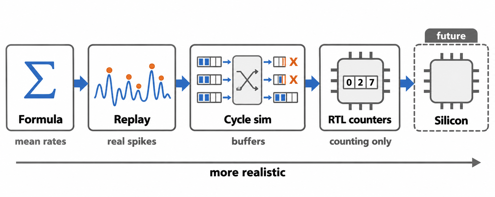<br>
  <em>Fig. 10. Formula, trace replay, cycle-level mesh simulation, RTL counters. Silicon is future work.</em>
</p>

### Seizure models (`step_E`)

1. **8-bit quantization:** AUC stays 1.000 on validation and test for all five models. Weight memory drops 75 % (e.g. SZ-L_dense 136 KB to 34 KB).
2. **Core memory audit** (limits scaled to 32 neurons, 128 axons, 512 synapses per core):

   | Model | Max synapses/core (naive / overlap) | Fits (naive / overlap) |
   |---|---|---|
   | SZ-S_dense | 520 / 512 | no / **yes** |
   | SZ-M_dense | 2048 / 2048 | no / no |
   | SZ-M_sparse | 192 / 192 | yes / yes |
   | SZ-L_dense | 4096 / 4096 | no / no |
   | SZ-L_sparse | 416 / 416 | yes / yes |

   Sparsity decides whether a seizure model fits. For SZ-L_sparse, overlap partitioning also cuts axon table entries from 1078 to 971 (-9.9 %).
3. **Cycle-accurate mesh replay** of real spike trains (record 18, one normal and one seizure window). ELP gain of the hypergraph-aware pipeline:

   | Model | Normal window | Seizure window |
   |---|---|---|
   | SZ-S_dense | +27.4 % | +51.5 % |
   | SZ-M_dense | +82.3 % | +78.0 % |
   | SZ-M_sparse | +75.6 % | +79.3 % |
   | SZ-L_dense | +15.0 % | +14.2 % |
   | SZ-L_sparse | +13.5 % | **+27.6 %** |

   SZ-L_sparse gains about twice as much during the seizure burst, when the chip is busiest. This is a lead, not a proof (one window of each kind).
4. **Verilog router simulation** (SZ-L_sparse, first 256 seizure cycles at 100 MHz, Icarus Verilog + Yosys synthesis):

   | Counter | Naive | Hypergraph | Change |
   |---|---|---|---|
   | Packets | 34,407 | 32,616 | -5.2 % |
   | Mesh hops | 73,724 | 60,220 | -18.3 % |
   | Router energy (pJ) | 441,856 | 368,591 | -16.6 % |

<p align="center">
  <br>
  <em>Fig. 11. Seizure hardware checks: test AUC after 8-bit quantization (left), router stall cycles in the seizure window (middle), cycle-accurate ELP gain (right).</em>
</p>

### Motor-imagery models (`step_G`)

We asked four questions. First, the checks themselves were validated: saved models reload exactly, spike traces reproduce bit for bit, BatchNorm folds exactly into the conv, regenerated placements reproduce the saved ELP tables, and the cycle-level simulator passes its test suite.

**Q1. Does the gain survive simulation? Yes.** D vs A is +27.5 to +61.7 % (formula), +27.6 to +61.8 % (trace replay), +31.7 to +59.9 % (cycle-level ELP), and +16.3 to +33.9 % (cycle-level network time). D has the lowest cycle-level ELP in 9 of 9 models, and the gain stays between +32 and +61 % for FIFO buffer depths 2, 4, 8 and unbounded. Placement alone (B) is weaker in simulation: its network time is worse than A on the three L models.

<p align="center">
  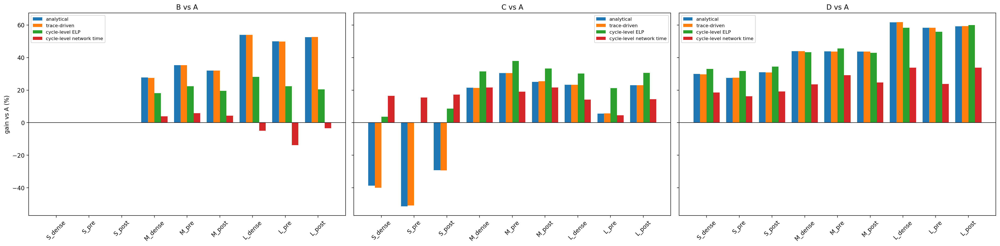<br>
  <em>Fig. 12. Gains by evidence level: B vs A, C vs A, D vs A.</em>
</p>

**Q2. What if we add traffic the formula ignores? The gain shrinks, and a single input port can remove it.** We added front-end (FE) traffic (the conv layer feeds analog current to the first spiking layer every step) and LayerNorm (LN) traffic.

| Traffic scenario | D vs A cycle-level ELP gain |
|---|---|
| Spike only | +31.7 to +59.9 % |
| Plus LN | +29.3 to +59.2 % |
| Plus FE packed (one packet per hosting core) | +20.3 to +57.9 % |
| Plus FE per unit, 4 corner ports | +12.1 to +36.0 % |
| Plus FE per unit, best single corner | -23.1 to +8.8 % |
| Plus FE per unit, single port at (0,0) | -70.2 to -3.9 % |

The single-port cases are limited by serialization, so they are bounds, not design predictions. **Lesson: design the front end together with the mapping.**

<p align="center">
  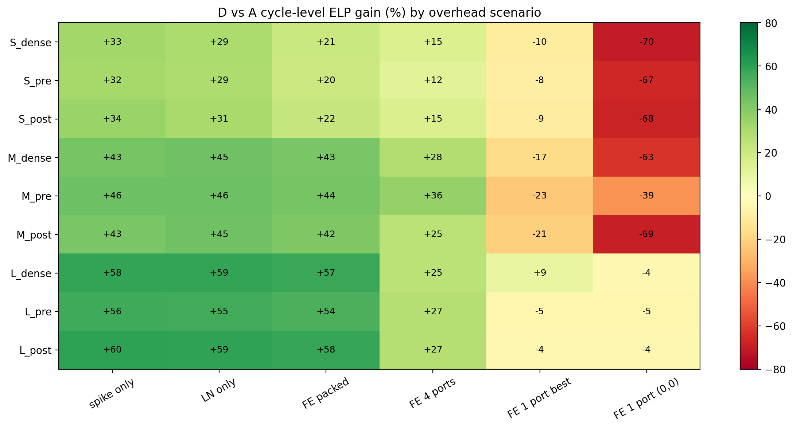<br>
  <em>Fig. 13. Cycle-level ELP gain of D vs A for 9 models and 6 traffic scenarios.</em>
</p>

**Q3. Does int8 keep the accuracy? It failed our declared gate, but the change is small.** The gate (declared in advance): paired accuracy drop of at most 1.0 point and at least 95 % prediction agreement. Result: 1 of 9 models pass with LN a (float LayerNorm), 0 of 9 with LN b (fixed-point LayerNorm). Int8 minus float32 is -1.4 to +1.3 points. The gate was partly unattainable: bf16 (training precision) and float32 of the same checkpoint already agree on only 93.2 to 96.5 % of predictions, so 3 of 9 models sit below 95 % before any quantization. The 95 % confidence interval reaches below -1.0 point in 16 of 18 cases, so a larger drop cannot be excluded. No saturation events. **4-bit weights collapse** (mean -9.96 points) and need quantization-aware training.

<p align="center">
  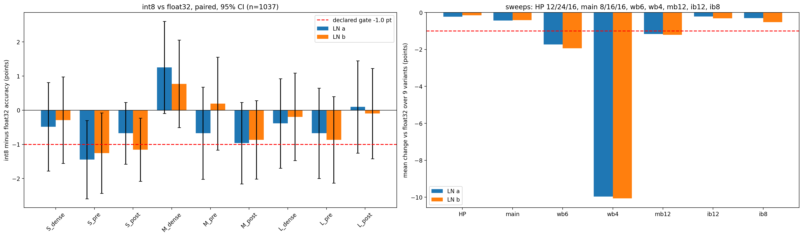<br>
  <em>Fig. 14. Left: int8 minus float32 accuracy with 95 % CI. Right: bit-width sweeps (HP = 12-bit weights, wb6, wb4, mb12, ib12, ib8).</em>
</p>

**Q4. Do the mappings fit memory and core limits? No.**

- **Memory:** weights-only savings from 50 % sparsity are 23 to 43 %, but once the index (CSR) is counted the saving is only **0.5 to 5.8 %**. Example: MI-L pre is 55.1 KiB weights-only, 96.6 KiB with index, against 97.1 KiB for MI-L dense.
- **Capacity:** the neuron limit (32) is enforced; axon (128) and synapse (512) limits are only reported. **18 of 18 partitions violate the synapse limit** (worst core 16x over) and 9 of 18 violate the axon limit. Overlap partitioning cuts axon violations (M: 2 to 0, L: 14 to 12) but not synapse violations. The violation is structural: a core holding 32 neurons already exceeds 512 synapses when fan-in is above 16. So **the motor-imagery results are communication-cost estimates for mappings that do not fit the assumed chip.**

<p align="center">
  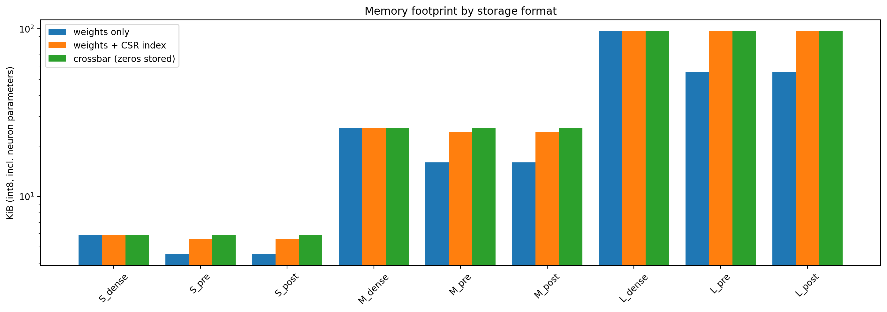<br>
  <em>Fig. 15. Memory footprint (int8) by storage format: weights only, weights plus CSR index, crossbar.</em>
</p>

<p align="center">
  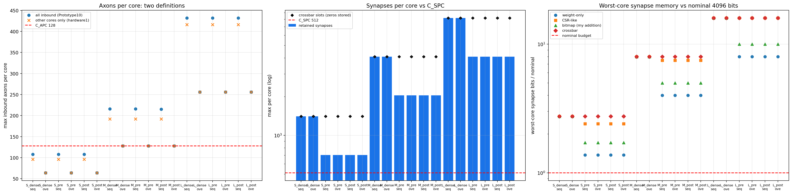<br>
  <em>Fig. 16. Capacity audit: inbound axons per core, synapses per core against the 512 limit, worst-core synapse memory.</em>
</p>

**RTL counters:** 88 of 88 RTL runs equal the Python reference and the trace-replay counts, and all 54 self-tests pass. Yosys synthesis gives 1,317 to 1,621 generic cells and 284 flops. This checks the accounting logic only. It is not a router and shows no congestion.

---

## What failed, and what we learned

The path was not straight. Failed ideas are part of the result.

<p align="center">
  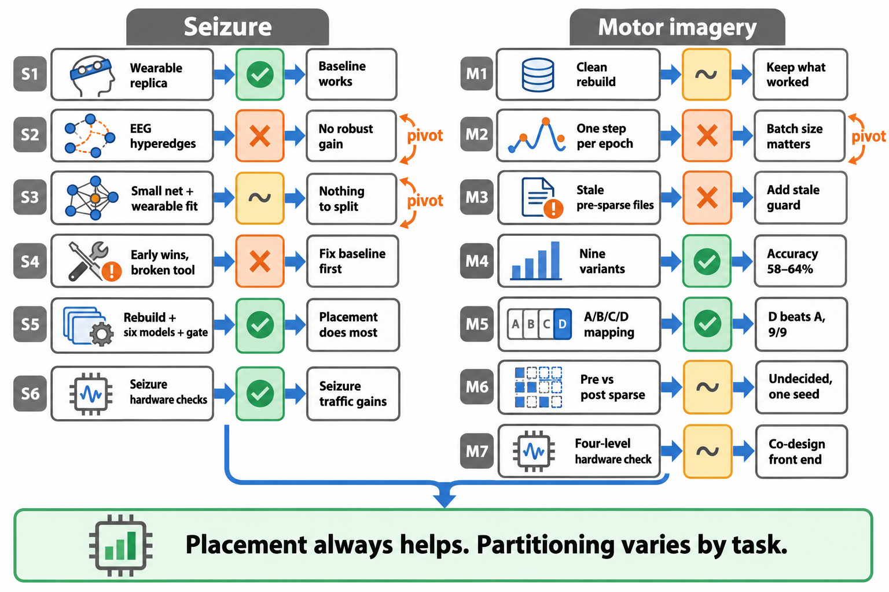<br>
  <em>Fig. 17. How each experiment guided the next, in a seizure arc and a motor-imagery arc. Green = worked, orange = failed, yellow-grey = mixed.</em>
</p>

| What we tried | What happened | What we did next |
|---|---|---|
| Group EEG channels into hyperedges before the encoder | Fixed 4 channels won (sensitivity 0.989 vs 0.968); the grouping needed a hand-tuned threshold | Dropped it, moved the hypergraph to the hardware side |
| Map the real 73-neuron model | Small or negative gain (-5.6 % to +27.9 % messages); about -24 % on a synthetic sparse network | Needed bigger, sparser, trained models |
| Wearable FPGA target | 529 weights fit in one core (nothing to split); 61 % of FPGA logic already used | Stopped designing for a wearable, asked "when does mapping pay off?" |
| First "90 % sparse winner" | Came from untrained networks, weak baselines, and a planted mask | **Withdrew the claim** |
| Deeper 417-neuron model | Mt-KaHyPar crashed, code silently fell back to a home-made method; model AUC only 0.83 | Stopped patching, rebuilt from the paper |
| First motor-imagery run | Batch 4,000 on 4,147 trials = 150 updates only | Retrained at batch 128 (4,800 updates); best-val rose from 54.7 / 58.3 / 57.3 to 58.6 / 62.9 / 63.7 |
| Old pre-sparse files next to new dense ones | False comparison | Added a stale-file guard, retrained, discarded old numbers |

**Key lessons:** (1) a comparison is only as good as its baseline; (2) fix the model (accuracy gate) before judging the mapping; (3) a broken tool is not a failed idea, and silent fallbacks hide what you are testing; (4) always ask where a gain comes from (the headline "pipeline wins by 7 to 48 %" became "placement wins, partitioning varies"); (5) count optimizer steps; (6) report the numerics floor next to a gate; (7) keep evidence levels separate; (8) design the front end with the mapping.

---

## Limitations (stated plainly)

- **Estimates, not measurements.** Loihi-small constants and small 32-neuron cores. Stall energy (0.45 pJ) and stall latency (2.1 ns) are assumptions. All "hardware" levels are simulations.
- **Seizure:** one patient, one split, 6 and 11 positive windows. AUC 1.0 does not prove generalization.
- **Motor imagery:** no held-out test set (validation is used for model choice, firing rates and reporting), pooled subjects, mixed sessions, one split, **one training seed**. Accuracy is not comparable with published numbers (82 to 84 % with per-subject training).
- **Capacity limits are audited, not enforced** inside the partitioner. No motor-imagery mapping fits.
- **Few baselines:** one naive baseline, no plain-graph model, no random placement, Mt-KaHyPar not in the final pipeline. Our overlap partitioner is a simpler greedy version of the published algorithm. The claim is "hypergraph-aware pipeline vs naive pipeline", not "hypergraph vs graph".
- **Simple placement search:** 1500 random swaps, never moves a core to an empty cell. Optimality is verified exhaustively only for the S networks.
- **Open causes:** why partitioning helps on dense motor-imagery networks but not dense seizure networks, and why C is worse than A on MI-S.
- **Narrow replays:** one normal and one seizure window for seizure; 32 trace windows (4 for the buffer test) for motor imagery. The depthwise conv is not modelled as synapses.
- **Int8 gate** was partly unattainable (numerics floor); 4-bit weights need quantization-aware training.

## Future work

Capacity-aware partitioning (limits inside the partitioner) and a plain-graph baseline, random placement and a working Mt-KaHyPar run | Design front end and mapping together (multi-port injection) | Session 0 to session 1 or leave-one-subject-out testing with more seeds | Quantization-aware training and structured or higher sparsity | A closer implementation of the published overlap algorithm and a stronger placement search | More replay windows, per-class rates, a second seizure patient, and a real RTL router before a multi-core FPGA design.

---

## Repository structure

```
.
├── images/                                  # fig01 ... fig17 (see list below)
├── notebooks/
│   ├── step_A_data_visualization.ipynb
│   ├── step_B_encoding_windowing.ipynb
│   ├── step_C1_model_architecture.ipynb
│   ├── step_C2_training_loop.ipynb
│   ├── step_D_hypergraph_mapping.ipynb
│   ├── step_E_hardware_verification_seizure.ipynb
│   ├── step_F_hypergraph_mapping_motor_imagery.ipynb
│   └── step_G_hardware_verification_motor_imagery.ipynb
├── requirements.txt
├── .gitignore
└── README.md
```

### Notebook guide

| Notebook | Task | What it does |
|---|---|---|
| `step_A_data_visualization` | Seizure | Load an EDF recording, plot the four target channels with the seizure interval, visualize the spike encoding |
| `step_B_encoding_windowing` | Seizure | 16-level one-hot spike encoder and 2048-step windowing with the 50 % overlap labelling rule |
| `step_C1_model_architecture` | Seizure | Build the 64-8-1 LIF network from scratch and verify shapes and spike traces |
| `step_C2_training_loop` | Seizure | Prove the training loop, loss and backward pass on a single fold |
| `step_D_hypergraph_mapping` | Seizure | Data and label audit, six-model ladder, accuracy gate, hypergraph extraction, naive vs hypergraph-aware mapping, placement-vs-partitioning ablation |
| `step_E_hardware_verification_seizure` | Seizure | 8-bit quantization, core memory audit, cycle-accurate mesh replay, Verilog router simulation (Icarus Verilog + Yosys) |
| `step_F_hypergraph_mapping_motor_imagery` | Motor imagery | BCI IV-2a data, nine models (dense, pre, post), hypergraph extraction, A/B/C/D ablation, final report |
| `step_G_hardware_verification_motor_imagery` | Motor imagery | Integer emulator (int8 and sweeps), SRAM audit, trace replay, cycle-level mesh, front-end and LayerNorm traffic, memory formats, RTL counters |

Run in order A to G: `step_E` loads models saved by `step_D`; `step_G` loads models, hypergraphs and traces saved by `step_F`.

### Figure list

| Figure | File | Section |
|---|---|---|
| 1 | `fig01_pipeline.png` | Pipeline |
| 2 | `fig02_graph_vs_hypergraph.png` | Pipeline |
| 3 | `fig03_before_after.png` | Pipeline |
| 4 | `fig04_mi_architecture.png` | Motor-imagery models |
| 5 | `fig05_seizure_analytical.png` | Seizure results |
| 6 | `fig06_seizure_shares.png` | Seizure results |
| 7 | `fig07_mi_hypergraph_extraction.png` | Motor-imagery results |
| 8 | `fig08_mi_ablation.png` | Motor-imagery results |
| 9 | `fig09_mi_accuracy_vs_elp.png` | Motor-imagery results |
| 10 | `fig10_verification_ladder.png` | Hardware verification |
| 11 | `fig11_seizure_hardware.png` | Hardware verification (seizure) |
| 12 | `fig12_mi_gains_by_evidence_level.png` | Hardware verification Q1 |
| 13 | `fig13_mi_overhead_sensitivity.png` | Hardware verification Q2 |
| 14 | `fig14_mi_quantization.png` | Hardware verification Q3 |
| 15 | `fig15_mi_memory_footprint.png` | Hardware verification Q4 |
| 16 | `fig16_mi_sram_audit.png` | Hardware verification Q4 |
| 17 | `fig17_decision_flow.png` | What failed, and what we learned |

## Setup

The notebooks were developed on **Google Colab with Google Drive** (NVIDIA L4 for training; a Tesla T4 for the step G reference run). Google Drive paths are hard-coded in the notebooks, so edit them to run elsewhere. Seed 42 throughout.

```bash
git clone <repo-url>
cd <repo-name>
pip install -r requirements.txt            # mne, moabb, snntorch, numba, numpy, pandas, torch, scikit-learn, matplotlib
sudo apt-get install iverilog yosys        # for the hardware notebooks (versions used: Icarus Verilog 12.0, Yosys 0.33)
```

- **Seizure notebooks:** need the CHB-MIT `chb01` EDF files and `chb01-summary.txt` (a `data.zip` on Drive).
- **Motor-imagery notebooks:** the dataset downloads automatically through MOABB (`BNCI2014_001`).
- Datasets, model checkpoints and cached arrays are **not** stored in this repository.

Main settings: 32 neurons per core, 1500 refinement swaps, placement seeds 42 to 46, seizure gate AUC 0.95, motor-imagery gate 50 % validation accuracy.

## References

Main reference: M. Ronzani and C. Silvano, *A case for hypergraphs to model and map SNNs on neuromorphic hardware*, arXiv:2601.16118, 2026. The hypergraph model, cost formulas and cost constants follow this paper. The seizure encoder and 64-8-1 network follow P. Busia et al., *Wearable epilepsy seizure detection on FPGA with spiking neural networks*, IEEE TBCAS, 2025. Full reference list is in the paper draft.

## Authorship and tool use

The data pipeline, spike encoder, windowing logic, SNN architecture and training loop were written independently from the research papers. AI assistance was used for code review, cross-checking results against the notebooks and paper, and drafting written analysis. Every number in this README comes from the saved notebook outputs and the paper draft.

## License

Add a license here before publishing.
