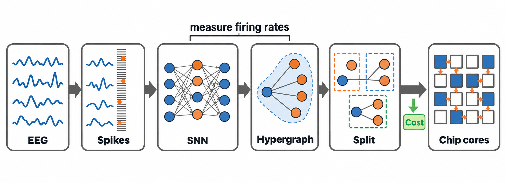
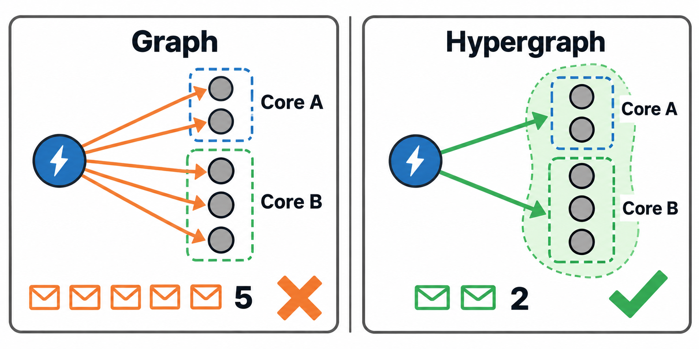
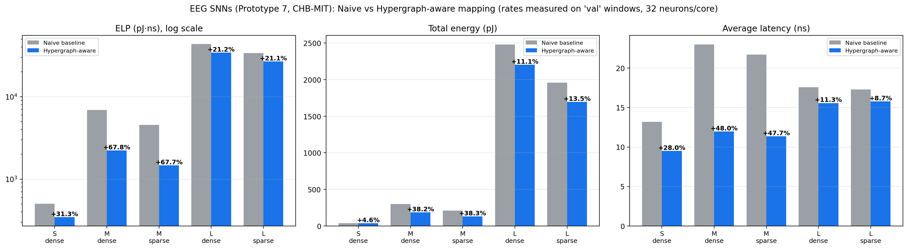
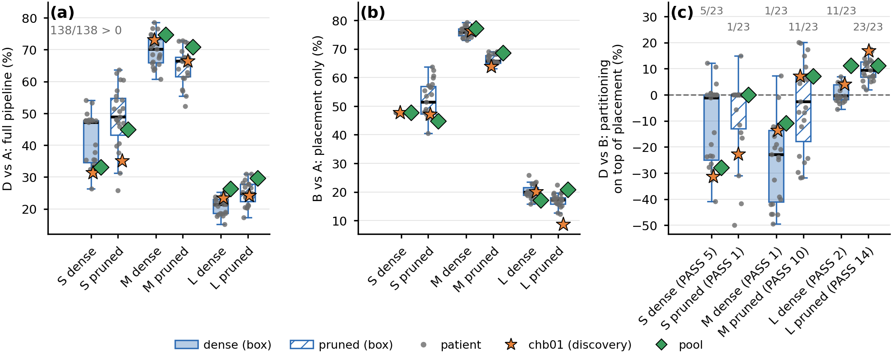
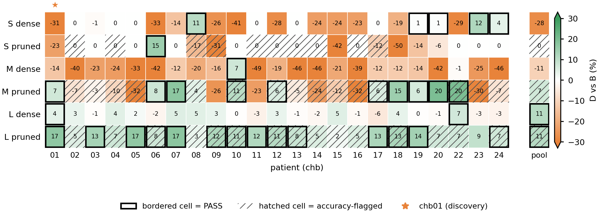
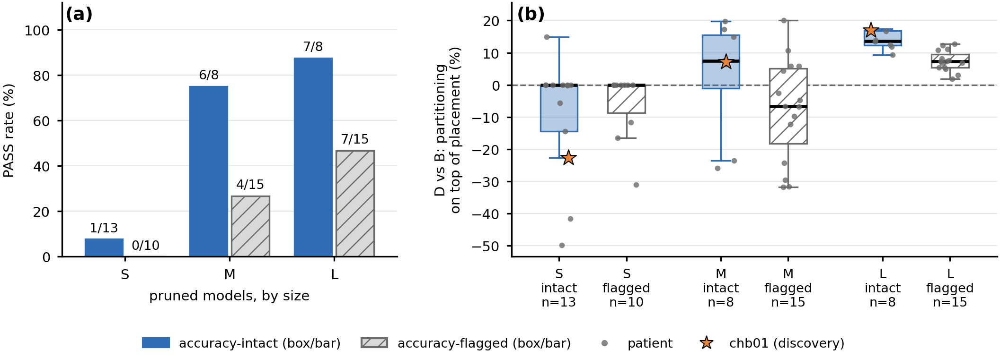
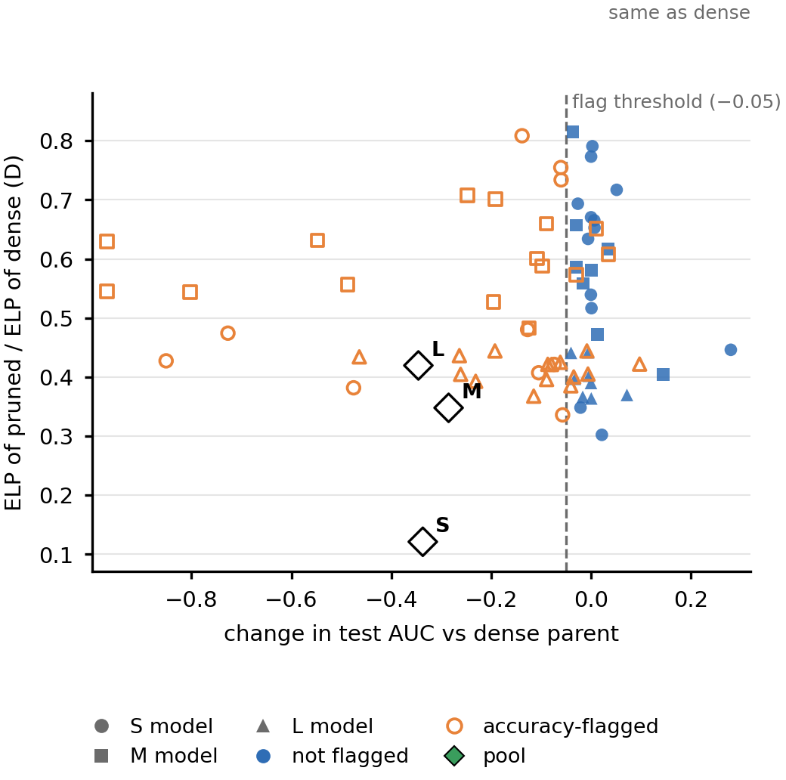
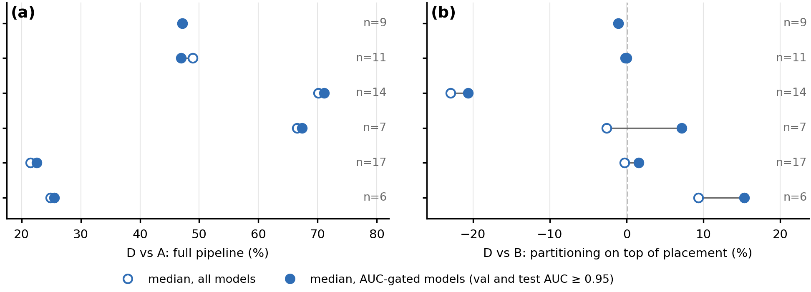
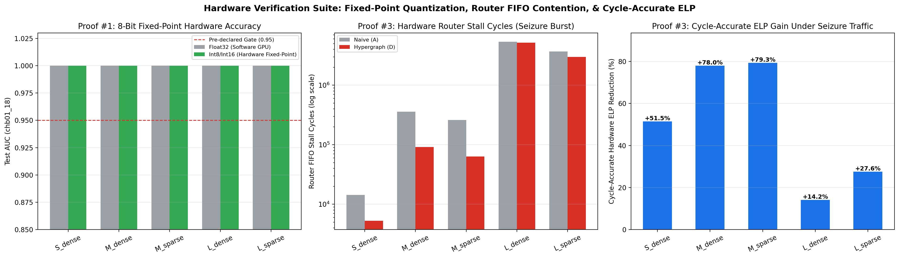
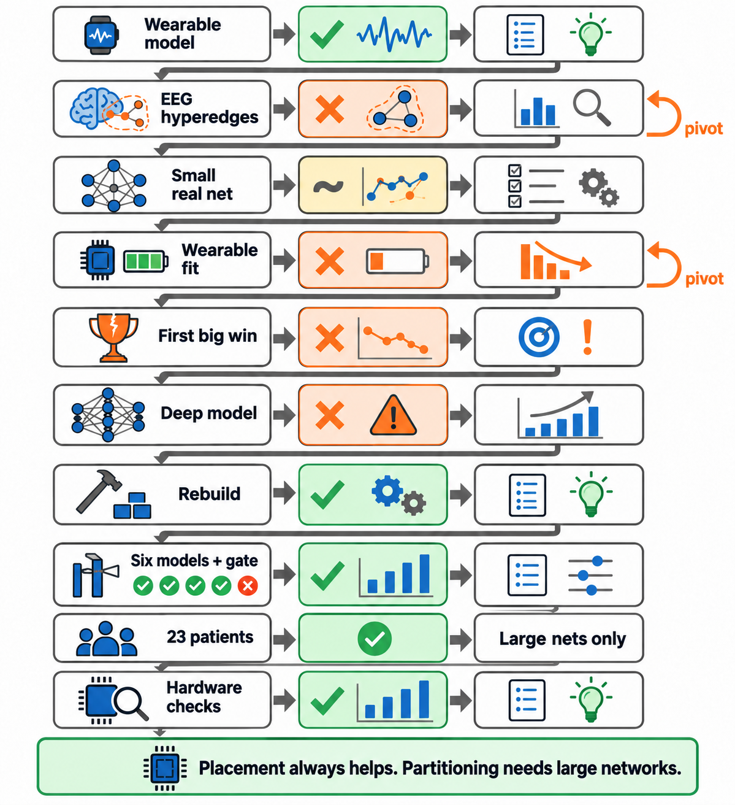

# Hypergraph-Aware Mapping of Seizure-Detecting Spiking Neural Networks onto Neuromorphic Cores

**Where does hypergraph mapping pay off for an EEG seizure detector? A study on 23 CHB-MIT patients (144 models).**

Data: CHB-MIT scalp EEG | Stack: PyTorch, MNE, snnTorch, Icarus Verilog, Yosys | All hardware results are **simulations**

[Project page](https://rishav-singh15.github.io/snn-mapping-explorer/) | [Project page repo](https://github.com/rishav-singh15/snn-mapping-explorer) | [Paper draft (PDF)](https://github.com/rishav-singh15/SNN-Seizure-Detection/blob/main/research%20draft/snn-new.pdf)

---

## In one minute

Brain-inspired chips are built from many small cores. When a neuron on one core sends a spike to a neuron on another core, the spike travels over an on-chip network, and that costs energy and time. So **which neurons share a core, and where each core sits on the chip, matters.**

This project:

1. Trains small spiking neural networks (SNNs) that detect **seizures in EEG** (CHB-MIT).
2. Turns each trained network into a **hypergraph**. A neuron sends the same spike to all its targets, so one hyperedge per sending neuron is a more honest model than many separate edges.
3. Compares a **hypergraph-aware mapping pipeline** with a **naive layer-order pipeline**, scored by the same cost model (energy-latency product, **ELP**, lower is better).
4. Asks the real question: **where does the gain come from, and does it hold on other patients and under more realistic hardware tests?**

> Energy and latency come from a Loihi-based cost model, **not from a physical chip**. Accuracy is only a gate here, because mapping never changes accuracy.

---

## The answer (short version)

| Question | Answer |
|---|---|
| Does the full hypergraph-aware pipeline beat the naive one? | **Yes.** On the five valid chb01 models, ELP is 23 to 73 % lower. On 23 patients (138 patient models) it won in **all 138**, by 15 to 79 %. |
| Where does the gain come from? | Mostly **traffic-aware placement**. It helps at every network size. |
| Does hypergraph partitioning add anything on top? | **Only on large pruned networks** (median +9.3 %, positive in 23 of 23 patients, clearly passing our screen in 14 of 23). Mixed on medium networks, nothing on small or dense ones. |
| Is a pruned model's lower cost a free gain? | **No.** Pruned models fire at 35 to 63 % of the dense rate, and 40 of 69 lost accuracy. |
| Does int8 keep accuracy? | **Yes** on chb01: AUC unchanged, weight memory down 75 %. |
| Do the models fit core memory limits? | **Sparse models fit, dense multi-layer models overflow** (by 4 to 8 times). |
| Does the gain show up under replay of real seizure spikes? | **Yes, and it is largest during a seizure.** SZ-L_sparse gains 27.6 % ELP in a seizure window vs 13.5 % in a normal window (one window of each kind, so a lead, not a proof). |

---

## How the pipeline works

<p align="center">
  <br>
  <em>Fig. 1. From EEG to estimated cost on chip cores: encode, train an SNN, measure firing rates, build the hypergraph, split into cores, place cores on the grid, score the cost.</em>
</p>

**Why a hypergraph?** A plain graph counts every connection as a message. A hypergraph counts one message per sending neuron and target core, because the target core copies the spike locally.

<p align="center">
  <br>
  <em>Fig. 2. A plain graph counts every connection as a message. A hypergraph counts one per sending neuron and core.</em>
</p>

**What the mapping does.** Neurons that talk a lot are grouped on the same core, and cores that talk a lot are placed close together.

<p align="center">
  <br>
  <em>Fig. 3. The same neurons on four cores before and after hypergraph-aware mapping. Fewer spikes cross between cores.</em>
</p>

### Cost model

Each spike that travels `d` hops costs `d (E_R + E_T) + E_R` energy and `d (L_R + L_T) + L_R` time, with E_R = 1.7 pJ, E_T = 3.5 pJ, L_R = 2.1 ns, L_T = 5.3 ns (Loihi-based constants from Ronzani and Silvano). Total energy is summed over deliveries weighted by the measured firing rate of the sending neuron. **ELP = energy x average latency.** The same scoring function is used for every method. Cores hold at most 32 neurons (a deliberately small core, so that small networks still have something to split).

### Four pipelines (the ablation)

| ID | Partitioning | Placement | What the comparison tells us |
|---|---|---|---|
| A | naive (layer order) | row by row | the baseline |
| B | naive | Hilbert curve + swap refinement | **B vs A = effect of placement** |
| C | hypergraph overlap | row by row | |
| D | hypergraph overlap | Hilbert curve + swap refinement | **D vs A = full pipeline; D vs B = what partitioning adds beyond placement** |

Each variant is run over 5 placement seeds (42 to 46). Gains below are written as D vs A, B vs A and D vs B. Positive means lower ELP than the reference.

---

## Data and models

**Data:** CHB-MIT scalp EEG, 256 Hz, four bipolar channels (F7-T7, T7-P7, F8-T8, T8-P8). Each sample becomes one spike on one of 16 amplitude levels, giving **64 input neurons** with exactly 4 active per step. Records are cut into 8-second windows (2048 steps), and a window is labelled seizure if at least half of it overlaps a seizure. Files are split by record, not by window, so neighbouring windows cannot leak between sets.

**Main study (patient chb01):**

| Set | Records | Windows | Seizure windows |
|---|---|---|---|
| Train | 03, 04, 15, 21, 26 | 2090 | 40 |
| Validation | 16 | 450 | 6 |
| Test | 18 | 450 | 11 |

**Six models per patient** (three sizes, each dense and 90 % sparse/pruned). LIF neurons, leak 0.9, threshold 1.0, fast-sigmoid surrogate gradient, non-spiking readout.

| Model | Layers | Synapses | Cores | chb01 accuracy gate |
|---|---|---|---|---|
| S_dense | 64-8-1 | 520 | 3 | pass |
| S_sparse | 64-8-1 | 56 | 3 | **fail** (AUC 0.414 / 0.048), left out |
| M_dense / M_sparse | 64-64-16-1 | 5136 / 496 | 5 | pass |
| L_dense / L_sparse | 64-128-128-64-32-1 | 34848 / 3488 | 14 | pass |

**Accuracy gate** (set before looking at any mapping result): output not dead, and validation and test AUC both at least 0.95. Only valid models are mapped in the chb01 study.

> AUC 1.0 on 6 and 11 seizure windows shows the models work, not that they generalize. Even one feature (spread of levels in a window) gives AUC 0.97 to 0.99, so accuracy cannot tell the models apart. We compare them on mapping cost instead.

---

## Results part 1: patient chb01

| Model | Cores | D vs A (full pipeline) | B vs A (placement) | D vs B (partitioning) |
|---|---|---|---|---|
| S_dense | 3 | +31.3 % | +47.7 % | -31.3 % |
| M_dense | 5 | +73.1 % | +76.3 % | -13.6 % |
| M_sparse | 5 | +70.0 % | +72.1 % | -7.7 % |
| L_dense | 14 | +23.4 % | +20.1 % | +4.1 % |
| L_sparse | 14 | +27.1 % | +18.1 % | **+11.0 %** |

5-seed means.

<p align="center">
  <br>
  <em>Fig. 4. Naive vs hypergraph-aware mapping for the five valid models (single run, seed 42): ELP (log scale), total energy, average latency.</em>
</p>

<p align="center">
  <br>
  <em>Fig. 5. Share of the total ELP gain that comes from placement and from partitioning.</em>
</p>

**Reading it simply:** placement does most of the work. Partitioning helps clearly only on the large sparse network, and that result repeated on an earlier, separately trained set of models (+13.7 %, then +11.0 %). In a dense layer every neuron talks to every neuron in the next layer, so any grouping looks the same to the partitioner. (This is our interpretation, not a directly tested cause.)

---

## Results part 2: 22 more patients and a pooled model

One patient can mislead. On chb01, L_dense just passed our screen (+4.1 %), but across patients its median is -0.3 %. So the same pipeline was run on **23 CHB-MIT patients** (chb01 to chb24 without chb21, which is the same subject as chb01) plus **one pooled model** trained on data from all patients: **144 models**, all mapped. Here the AUC gate is a *check*, not a filter. Pruned models are 90 % pruned with no fine-tuning, so some lost accuracy.

Medians over the 23 patients (positive is better):

| Group | D vs A (full) | B vs A (placement) | D vs B (partitioning) | D vs B > 0 | Passes screen |
|---|---|---|---|---|---|
| S dense | +47.1 | +47.7 | -1.1 | 5/23 | 5/23 |
| S pruned | +48.9 | +51.5 | 0.0 | 1/23 | 1/23 |
| M dense | +70.2 | +75.9 | -22.9 | 1/23 | 1/23 |
| M pruned | +66.5 | +65.9 | -2.6 | 11/23 | 10/23 |
| L dense | +21.5 | +19.9 | -0.3 | 11/23 | 2/23 |
| **L pruned** | +24.9 | +17.2 | **+9.3** | **23/23** | **14/23** |

The "screen" is a rough rule: D beats B by more than the sum of their standard deviations over 5 seeds. It is not a significance test.

<p align="center">
  <br>
  <em>Fig. 6. Gains over naive for 23 patients. (a) Full pipeline, (b) placement alone, (c) partitioning on top of placement. Orange star = chb01, green diamond = pooled model.</em>
</p>

<p align="center">
  <br>
  <em>Fig. 7. D vs B gain of every model. The large-pruned row is green in all 23 patient columns. Thick border = passes the screen.</em>
</p>

**Pruned models and accuracy.** Of 69 pruned patient models, 40 lost more than 0.05 AUC against their dense model ("flagged"). Among the pruned models that kept their accuracy, partitioning passes in 7 of 8 (L) and 6 of 8 (M), a promising lead on small groups. Pruned models also fire much less, and their ELP is only 0.41 to 0.59 of the dense ELP, so **part of their lower cost comes from lower activity and damage, not from a free gain.**

<p align="center">
  <br>
  <em>Fig. 8. Pruned models only, split by whether they kept their accuracy.</em>
</p>

<p align="center">
  <br>
  <em>Fig. 9. Cost vs accuracy change for pruned models. Lower cost comes together with accuracy loss.</em>
</p>

**Does the AUC gate change the answer?** No. On the 64 of 138 patient models that pass the gate, the full pipeline still wins in all 64, and the partitioning pattern is the same (L pruned +15.3 %, PASS in 5 of 6).

<p align="center">
  <br>
  <em>Fig. 10. Effect of the AUC gate: median over all models (hollow) vs over gate-passing models (filled).</em>
</p>

**Pooled model.** Pooled L_dense and L_pruned both gain +11.2 % from partitioning, supporting the large-network result. Pooled M is inconclusive and pooled S gains nothing. The three pooled pruned models are badly damaged (test AUC 0.59 to 0.67), and the pool is one model per size, so it supports the L result but is not a second independent sample.

---

## Hardware verification (chb01 models, all in simulation)

The formulas assume average rates, 32-bit floats and one core limit. So the chb01 models were re-checked four ways, without changing any trained weight.

<p align="center">
  <br>
  <em>Fig. 11. Left: test AUC after 8-bit quantization. Middle: router stall cycles in the seizure window (log scale). Right: cycle-accurate ELP gain in the seizure window.</em>
</p>

1. **8-bit quantization.** AUC stays 1.000 on validation and test for all five models. Weight memory drops 75 % (for example L_dense: 136 KB to 34 KB).
2. **Core memory audit** (limits scaled to 32 neurons, 128 axons, 512 synapses per core):

   | Model | Max synapses/core (naive / overlap) | Fits (naive / overlap) |
   |---|---|---|
   | S_dense | 520 / 512 | no / **yes** |
   | M_dense | 2048 / 2048 | no / no |
   | M_sparse | 192 / 192 | yes / yes |
   | L_dense | 4096 / 4096 | no / no |
   | L_sparse | 416 / 416 | yes / yes |

   Sparsity decides whether a model fits. For L_sparse, overlap partitioning also cuts axon table entries from 1078 to 971 (-9.9 %). These limits are our own choice, so this shows the effect of sparsity and does not prove that a specific chip would accept the models.
3. **Cycle-accurate mesh replay** of real spike trains (record 18, one normal and one seizure window), 2D mesh with X-then-Y routing. ELP gain of the hypergraph-aware pipeline:

   | Model | Normal window | Seizure window |
   |---|---|---|
   | S_dense | +27.4 % | +51.5 % |
   | M_dense | +82.3 % | +78.0 % |
   | M_sparse | +75.6 % | +79.3 % |
   | L_dense | +15.0 % | +14.2 % |
   | L_sparse | +13.5 % | **+27.6 %** |

   For L_dense, the packet count is identical in both pipelines (a dense network must reach every core of the next layer whatever the grouping). For L_sparse, overlap partitioning removes 14,523 packets in the seizure window. L_sparse gains about twice as much during the seizure burst, when the chip is busiest.
4. **Verilog router simulation** (L_sparse, first 256 seizure cycles at 100 MHz, Icarus Verilog + Yosys):

   | Counter | Naive | Hypergraph | Change |
   |---|---|---|---|
   | Packets | 34,407 | 32,616 | -5.2 % |
   | Mesh hops | 73,724 | 60,220 | -18.3 % |
   | Router energy (pJ) | 441,856 | 368,591 | -16.6 % |

None of these is a measurement on a chip. They test different things: the model output with 8-bit arithmetic, fit under limits we chose, traffic under our routing model, and a few router counters.

---

## Interactive dashboard and project page

A separate repository holds a small web dashboard that replays a recorded EEG hour (record 18, patient chb01) through one trained model (M_sparse, 145 neurons, 5 cores). It shows the network, the simulated chip and the traffic for both pipelines side by side, and lets you hover over a neuron to see its hyperedge. It is a visual aid for this work, not a clinical tool and not a new result.

- **Live page:** https://rishav-singh15.github.io/snn-mapping-explorer/
- **Code:** https://github.com/rishav-singh15/snn-mapping-explorer

---

## What failed, and what we learned

The path was not straight, and the failed ideas are part of the result.

<p align="center">
  <br>
  <em>Fig. 12. How the result of each experiment guided the next. Green = worked, orange = failed.</em>
</p>

| What we tried | What happened | What we did next |
|---|---|---|
| Replicate the wearable 64-8-1 detector | AUC 0.998, event sensitivity 1.0, but more false alarms and one dead fold | Used it as the base for later work |
| Group EEG channels into hyperedges before the encoder | Fixed 4 channels won (sensitivity 0.989 vs 0.968); grouping needed a hand-tuned threshold | Dropped it, moved the hypergraph to the hardware side |
| Map the real 73-neuron model | Small or negative gain (-5.6 % to +27.9 % messages); about -24 % on a synthetic sparse network | Needed bigger, sparser, trained models |
| Wearable FPGA target | 529 weights fit in one core (nothing to split); 61 % of FPGA logic already used | Stopped designing for a wearable, asked "when does mapping pay off?" |
| First "90 % sparse winner" | Came from untrained networks, weak baselines and a planted mask | **Withdrew the claim** |
| Deeper 417-neuron model | Mt-KaHyPar crashed, code silently fell back to a home-made method, AUC only 0.83 | Stopped patching, rebuilt from the paper |

**Key lessons:** (1) a comparison is only as good as its baseline; (2) fix the model (accuracy gate) before judging the mapping; (3) a broken tool is not a failed idea, and silent fallbacks hide what you are testing; (4) always ask where a gain comes from (the headline "pipeline wins by 7 to 48 %" became "placement wins, partitioning varies"); (5) one patient can mislead, so check other patients; (6) a cheaper model is not a better model, so read cost together with accuracy; (7) report the negative results.

---

## Limitations (stated plainly)

- **Estimates, not measurements.** Loihi-based constants and small 32-neuron cores. All hardware levels are simulations.
- **Few seizures, one seed.** For chb01 the validation and test files hold 6 and 11 seizure windows. Each model was trained with one seed, and per-patient AUC is noisy.
- **Pruned models are not like-for-like.** They are prune-only with no fine-tuning, and they fire less than dense models.
- **The pooled result is one model per size**, not a second sample.
- **Hardware checks and the dashboard use chb01 only.** The other 22 patients were scored with the analytical cost model only.
- **Axon and synapse limits are audited, not enforced** inside the partitioner.
- **Few baselines.** One naive baseline, no plain-graph model, and Mt-KaHyPar is not in the final pipeline. Our overlap partitioner is a simpler greedy version of the published algorithm. The claim is "hypergraph-aware pipeline vs naive pipeline", not "hypergraph vs graph". We did not run SpiNeMap, SNEAP, EdgeMap or the tools of Ronzani and Silvano.
- **Simple placement search.** 1500 random swaps, never moves a core to an empty cell. The screen used for verdicts is rough, not a significance test.
- **Rates come from mostly calm EEG**, and the replay covers one normal and one seizure window.
- **Short training** (165 optimizer steps per model).

## Future work

Use axon and synapse limits inside the partitioner, add a plain-graph baseline and runs of earlier mapping tools | Implement the published overlap algorithm more closely and improve the placement search | Test recurrent and skip-connection topologies | Replay more windows, measure per-class rates, run the hardware checks on more patients, train more seeds, fine-tune pruned models | Extend the dashboard to other models and patients | Move from simulated mesh cost to a multi-core FPGA design with measured resource use.

---

## Repository structure

```
.
├── images/                                  # figures used in this README
├── notebooks/
│   ├── step_A_data_visualization.ipynb
│   ├── step_B_encoding_windowing.ipynb
│   ├── step_C1_model_architecture.ipynb
│   ├── step_C2_training_loop.ipynb
│   ├── step_D_hypergraph_mapping.ipynb
│   ├── step_E_hardware_verification.ipynb
│   ├── step_F_train_all_patient_models.ipynb
│   └── step_G_hypergraph_mapping_all_patients.ipynb
├── research draft/
│   └── snn-new.pdf                          # the paper draft
├── requirements.txt
├── .gitignore
└── README.md
```

### Notebook guide

| Notebook | Scope | What it does |
|---|---|---|
| `step_A_data_visualization` | chb01 | Load an EDF recording, plot the four target channels with the seizure interval, visualize the spike encoding |
| `step_B_encoding_windowing` | chb01 | 16-level one-hot spike encoder and 2048-step windowing with the 50 % overlap labelling rule |
| `step_C1_model_architecture` | chb01 | Build the 64-8-1 LIF network from scratch and verify shapes and spike traces |
| `step_C2_training_loop` | chb01 | Prove the training loop, loss and backward pass on a single fold |
| `step_D_hypergraph_mapping` | chb01 | Data and label audit, six-model ladder, accuracy gate, hypergraph extraction, naive vs hypergraph-aware mapping, placement-vs-partitioning ablation |
| `step_E_hardware_verification` | chb01 | 8-bit quantization, core memory audit, cycle-accurate mesh replay, Verilog router simulation (Icarus Verilog + Yosys) |
| `step_F_train_all_patient_models` | 23 patients + pooled | Trains all dense and pruned models (S, M, L) for every patient and the pooled set, with reload and synapse-count checks |
| `step_G_hypergraph_mapping_all_patients` | 23 patients + pooled | Hypergraph extraction and the A/B/C/D mapping ablation for all 144 models, plus the gate-as-check analysis |

Run in order A to G: `step_E` loads models saved by `step_D`, and `step_G` loads the models saved by `step_F`.

## Setup

The notebooks were developed on **Google Colab with Google Drive**. Google Drive paths are hard-coded in the notebooks, so edit them to run elsewhere. Seed 42 is used throughout.

```bash
git clone https://github.com/rishav-singh15/SNN-Seizure-Detection.git
cd SNN-Seizure-Detection
pip install -r requirements.txt            # mne, snntorch, numba, numpy, pandas, torch, scikit-learn, matplotlib
sudo apt-get install iverilog yosys        # for the hardware notebook (versions used: Icarus Verilog 12.0, Yosys 0.33)
```

- The notebooks need the CHB-MIT EDF files and the patient summary files from [PhysioNet](https://physionet.org/content/chbmit/1.0.0/).
- Datasets, model checkpoints and cached arrays are **not** stored in this repository.

Main settings: 32 neurons per core, 1500 refinement swaps, placement seeds 42 to 46, gate AUC 0.95.

## References

Main reference: M. Ronzani and C. Silvano, *A case for hypergraphs to model and map SNNs on neuromorphic hardware*, arXiv:2601.16118, 2026. The hypergraph model, cost formulas and cost constants follow this paper. The seizure encoder and the 64-8-1 network follow P. Busia et al., *Wearable epilepsy seizure detection on FPGA with spiking neural networks*, IEEE TBCAS, 2025. The full reference list is in the [paper draft](https://github.com/rishav-singh15/SNN-Seizure-Detection/blob/main/research%20draft/snn-new.pdf).

## Authors

Rishav Singh and Dr. Sarika Patil, Department of Electrical and Electronics Engineering, Dr. Vishwanath Karad MIT World Peace University, Pune, India.

## Authorship and tool use

The data pipeline, spike encoder, windowing logic, SNN architecture and training loop were written independently from the research papers. AI assistance was used for code review, cross-checking results against the notebooks and paper, and drafting written analysis. Every number in this README comes from the saved notebook outputs and the paper draft.
