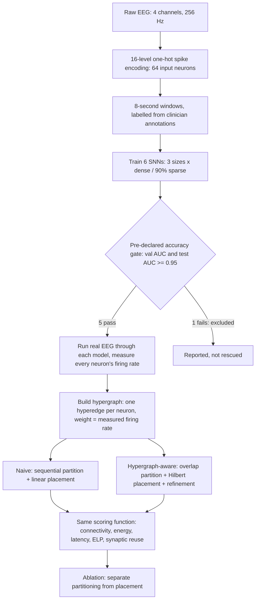
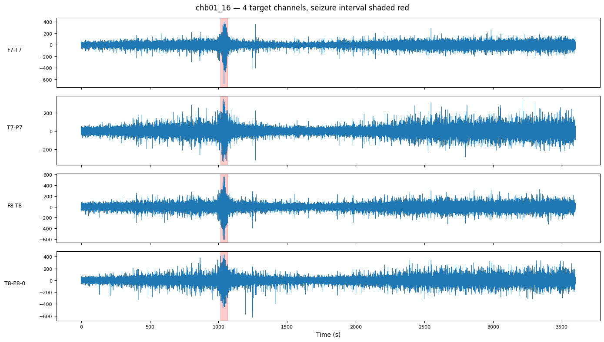
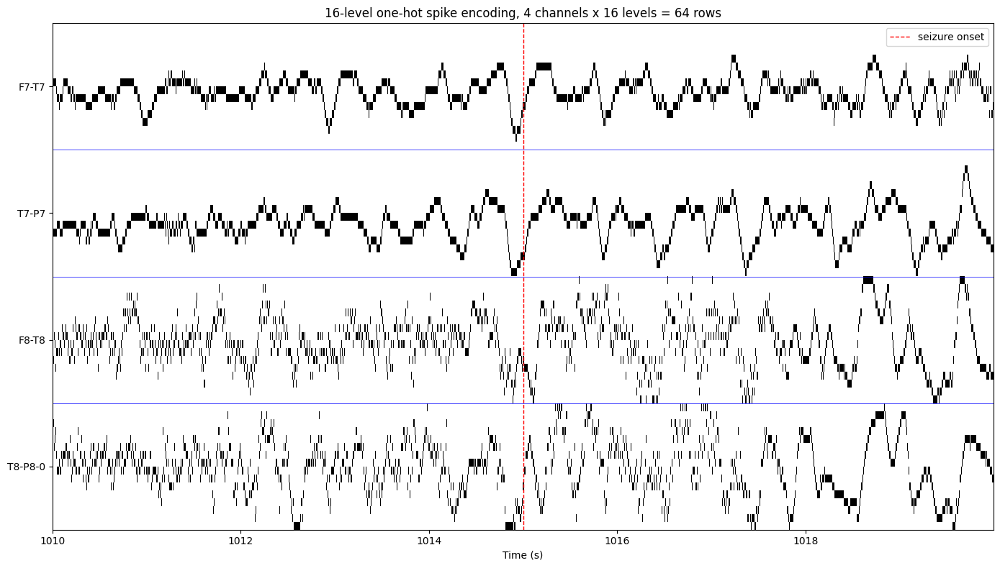
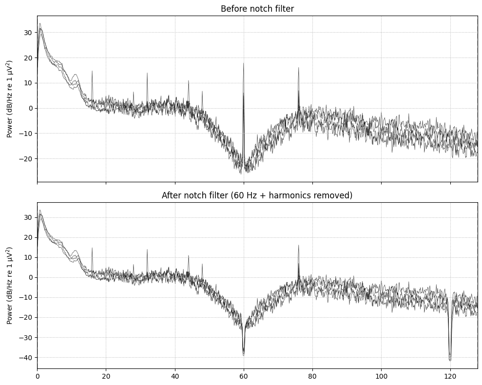
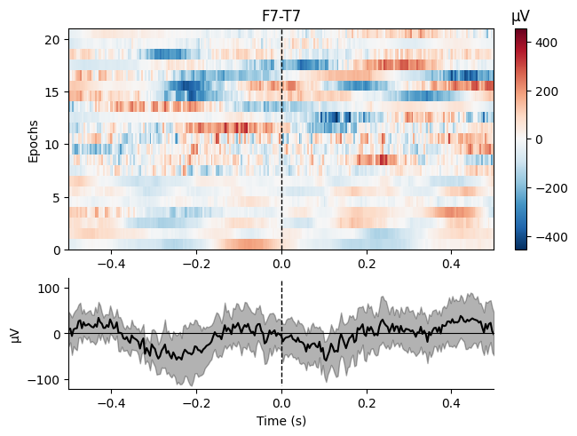
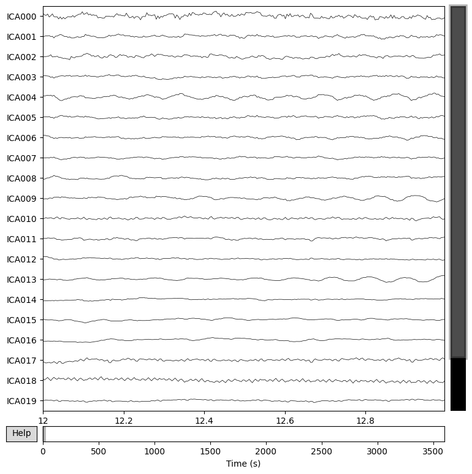
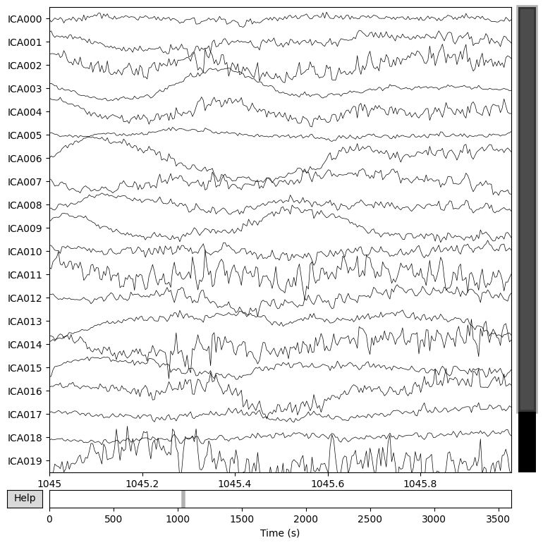

# Hypergraph-Aware Mapping of a Seizure-Detecting Spiking Neural Network

**EEG seizure detection with a Spiking Neural Network (SNN), and a hypergraph-based method for deciding how its neurons are laid out on neuromorphic hardware cores.**

Dataset: CHB-MIT Scalp EEG Database (patient chb01) | Stack: PyTorch, snnTorch, MNE-Python, NumPy, scikit-learn | Status: **Capstone complete**

---

## In one minute (for non-specialists)

Brain-inspired chips run neural networks as a city of small processing "post offices" (cores). Every spike (a short message between neurons) that has to travel from one core to another costs energy and time. **Where each neuron lives, and where each core sits on the chip, decides how much that traffic costs.**

This project does three things:

1. **Detects seizures from EEG** with a spiking neural network that is small enough to be a realistic hardware target.
2. **Models the trained network as a hypergraph**, a graph in which one edge can connect one sender to many receivers. This matches how a neuron really works: one spike is broadcast along one axon to many targets, so counting it as many separate messages overestimates the traffic.
3. **Uses that hypergraph to plan the hardware layout** (which neurons share a core, and where each core is placed) and measures how much estimated energy and delay it saves against a naive layout.

**Result:** on five trained, validated networks the hypergraph-aware layout lowered the estimated energy-latency product (ELP) by **23% to 73%** against a naive layer-by-layer layout (5-seed means). A controlled ablation then showed *where* the gain comes from: most of it is traffic-aware **placement**, while hypergraph-aware **partitioning** adds a measurable extra benefit on the large networks (+4.1% dense, **+11.0% sparse**). The sparse-network result replicated an earlier independent run (+13.7%).

> All energy and latency figures are **analytical estimates** from a published Loihi-derived cost model, not measurements on physical hardware.

---

## Final result

<p align="center">
  <br>
  <em>Naive layer-order mapping versus the hypergraph-aware mapping pipeline on the five accuracy-validated EEG-trained SNNs, scored by the same cost function. Lower is better. The hypergraph-aware pipeline wins on every model; the largest gains appear on the medium networks, and the large networks gain 21%.</em>
</p>

### Headline numbers

32 neurons per core, Loihi-derived cost constants (Ronzani and Silvano, Table II). Single run, seed 42, 1500 refinement swaps.

| Model | Architecture | Cores | ELP naive | ELP hypergraph | ELP gain | Energy gain | Latency gain |
|---|---|---|---|---|---|---|---|
| S_dense | 64-8-1 | 3 | 501.6 | 344.4 | 31.3 % | 4.6 % | 28.0 % |
| M_dense | 64-64-16-1 | 5 | 6908.5 | 2223.5 | 67.8 % | 38.2 % | 48.0 % |
| M_sparse | 64-64-16-1 (90 % sparse) | 5 | 4557.7 | 1471.3 | 67.7 % | 38.3 % | 47.7 % |
| L_dense | 64-128-128-64-32-1 | 14 | 43583.6 | 34332.5 | 21.2 % | 11.1 % | 11.3 % |
| L_sparse | 64-128-128-64-32-1 (90 % sparse) | 14 | 33864.7 | 26734.0 | 21.1 % | 13.5 % | 8.7 % |

Placement is randomized, so single runs vary. Averaged over 5 seeds, the full-pipeline ELP gain is **31.3 / 73.1 / 70.0 / 23.4 / 27.1 %** (S_dense / M_dense / M_sparse / L_dense / L_sparse). Energy is the more conservative metric (4.6 to 38 %).

### Where does the gain come from? (ablation, 5 seeds)

A win is only a result once you know where it comes from, so the pipeline was split into its two ingredients and every combination was run:

| Code | Partitioning (who shares a core) | Placement (where cores sit) |
|---|---|---|
| A | naive, by layer order | linear, row by row |
| B | naive, by layer order | Hilbert curve + force-directed refinement |
| C | hypergraph overlap | linear |
| D | hypergraph overlap | Hilbert curve + force-directed refinement (**full pipeline**) |

| Model | D vs A (full pipeline) | B vs A (placement alone) | **D vs B (partitioning, fair test)** | Verdict on partitioning |
|---|---|---|---|---|
| S_dense | +31.3 % | +47.7 % | -31.3 % | no benefit |
| M_dense | +73.1 % | +76.3 % | -13.6 % | inconclusive |
| M_sparse | +70.0 % | +72.1 % | -7.7 % | inconclusive |
| L_dense | +23.4 % | +20.1 % | **+4.1 %** | small benefit |
| L_sparse | +27.1 % | +18.1 % | **+11.0 %** | **clear benefit** |

**What this tells us**

- The full hypergraph-aware pipeline beats the naive pipeline on **every** model.
- Most of the gain is **traffic-aware placement**. This is still the hypergraph at work, since the hyperedge-weighted traffic model is what drives the placement cost.
- **Hypergraph partitioning pays off where the network is large and randomly wired.** Sparse wiring produces different sets of shared inputs, which gives the partitioner something to find. Dense layers connect everything to everything, so any grouping looks the same (synaptic reuse is identical at 29.42 before and after).
- The deep sparse result **replicates**: +13.7 % on an earlier independently trained model set, +11.0 % here.

---

## How the pipeline works



### Stage 1: EEG to spikes
Four scalp channels (F7-T7, T7-P7, F8-T8, T8-P8) are encoded into 16 amplitude levels per channel as one-hot spikes. That gives 64 input neurons and exactly 4 input spikes per time step. The signal is cut into 8-second windows (2048 samples), and a window is labelled "seizure" when at least 50 % of it overlaps a clinician-annotated seizure.

| Split | Record | Windows | Seizure windows |
|---|---|---|---|
| Train | chb01_03, 04, 15, 21, 26 | 2090 | 40 (1.9 %) |
| Validation | chb01_16 | 450 | 6 (1.3 %) |
| Held-out test | chb01_18 | 450 | 11 (2.4 %) |

A **label audit** against the official `chb01-summary.txt` confirmed that all seizure intervals in the code match the summary and that the cached training labels fall exactly on the expected windows.

### Stage 2: A ladder of six spiking networks
Leaky integrate-and-fire neurons (leak 0.9, threshold 1.0, reset by subtraction), a fast-sigmoid surrogate gradient, and a non-spiking leaky-integrator readout. Three sizes, each as a dense network and as a 90 % sparse twin with fixed fan-in masks.

| Key | Layers | Neurons | Synapses |
|---|---|---|---|
| S_dense / S_sparse | 64-8-1 | 73 | 520 / 56 |
| M_dense / M_sparse | 64-64-16-1 | 145 | 5,136 / 496 |
| L_dense / L_sparse | 64-128-128-64-32-1 | 417 | 34,848 / 3,488 |

One training recipe for all (Adam, learning rate 2e-3, batch 64, 5 epochs, 165 optimizer steps per model, gradient clipping, best checkpoint by validation AUC).

### Stage 3: Accuracy gate
Before any hardware conclusion, a validity rule was declared in advance: **no dead output, and AUC of at least 0.95 on both the validation file and a separate held-out test file** (decision threshold chosen on training data only).

| Model | AUC train | AUC val | AUC test | Test sensitivity | Test specificity | Gate |
|---|---|---|---|---|---|---|
| S_dense | 0.9885 | 1.0000 | 1.0000 | 1.000 | 1.000 | PASS |
| S_sparse | 0.1512 | 0.4144 | 0.0476 | 0.818 | 0.000 | **FAIL** |
| M_dense | 0.9811 | 1.0000 | 1.0000 | 1.000 | 1.000 | PASS |
| M_sparse | 0.9843 | 1.0000 | 1.0000 | 1.000 | 1.000 | PASS |
| L_dense | 0.9890 | 1.0000 | 1.0000 | 1.000 | 1.000 | PASS |
| L_sparse | 0.9853 | 1.0000 | 1.0000 | 1.000 | 1.000 | PASS |

Five of six models pass. `S_sparse` fails because a 90 % sparse 64-to-8 layer leaves **33 of the 64 input levels connected to no hidden neuron**, so the model sees only about half of the input. It was excluded by the rule and **not tuned to rescue it**. Every saved model was also verified to reload exactly (maximum logit difference 0.00e+00).

### Stage 4: Hypergraph extraction
For each valid model, real EEG windows are run through the network and every neuron's firing rate is measured. The hypergraph then has one **hyperedge per source neuron**: the source, all the neurons it connects to, and a weight equal to its **measured** firing rate. Rates are always measured, never read from the weights.

- Input rates sum to exactly 4.000 on every model (4 channels x 1 spike per step), a built-in correctness check.
- Synapse counts recovered from the hypergraph match the trained models exactly.
- Rates measured on validation windows and on training windows correlate at **r = 0.990 to 0.998**, so the choice of rate split does not change the picture.

### Stage 5: Mapping, two pipelines, one scoring function
| | Naive baseline | Hypergraph-aware |
|---|---|---|
| Partitioning | Fill cores in neuron-ID (layer) order. Ignores rates and wiring | **Overlap partitioning:** seed each core with the busiest unassigned neuron, then keep adding the neuron that shares the most incoming hyperedges with the core |
| Placement | Cores row by row | **Hilbert curve** start, then **force-directed refinement** (random swaps kept only if the cost improves) |
| Uses measured data | No | Yes |

Both are scored by the **same** `evaluate_mapping` function: weighted connectivity (the hypergraph "lambda minus 1" measure), energy, latency, ELP and synaptic reuse. Energy per delivery is `d x (E_R + E_T) + E_R` and latency is `d x (L_R + L_T) + L_R`, where d is the number of hops, with E_R = 1.7 pJ, E_T = 3.5 pJ, L_R = 2.1 ns and L_T = 5.3 ns.

---

## How the project got here (including what failed)

The final result is the product of several earlier attempts that failed or were inconclusive, and each one removed a specific doubt.

| Stage | What happened | What it taught |
|---|---|---|
| Replication | Rebuilt a published 64-8-1 SNN on chb01 (AUC about 0.998) | A working, honestly benchmarked baseline |
| EEG-side hypergraph | Aggregating EEG channels into hyperedges before encoding did not beat four fixed channels | A negative result, reported openly. It moved the focus to the **hardware-mapping side** |
| First mapping pipeline | A "90 % sparse winner" did not survive review: weak baseline, planted mask, untrained network | A comparison is only as good as its baseline |
| Prototype 6 | Inconclusive. A hypergraph library crashed, two "different" methods were the same code, and the headline network failed its own accuracy gate | Tooling and experiment design were at fault, not the idea. It also showed that a plain-graph traffic model **overcounts** spike traffic by **6.9x to 31.5x** versus the hypergraph model |
| Rebuild (4_HG, 5_HG) | Rewrote the pipeline from the paper, proved it on controlled synthetic data (ELP gains of 33 / 21 / 34 %), then moved it to real EEG models and ran a first ablation | Prove the method on controlled data first, then ask *where* a gain comes from |
| **Prototype 7 (this notebook)** | Fixed the foundation first: six models, one recipe, a gate on both validation and held-out test files, a label audit and a reload check | The first run where every earlier lesson held at once |

**Lessons that shaped the final design**

1. Fix the foundation (valid models, correct labels) before drawing hardware conclusions.
2. Use the same evaluator for every method and change only the method.
3. A win is not a result until an ablation shows where it comes from.
4. Pre-declare the validity rule and obey it, even when it removes a model.
5. Replicate on independently trained models.
6. Prefer the conservative metric (energy) for headlines, and report failures.

---

## Limitations (stated plainly)

- Energy and latency are **analytical estimates** on Loihi-derived constants with deliberately scaled-down 32-neuron cores, not measurements on real hardware.
- **One patient (chb01).** The validation and test files each contain a single seizure event (6 and 11 positive windows), so AUC 1.0 shows the models are functional, not that they generalize.
- Hardware limits on incoming axons and synapses per core are checked in design but **not enforced** during partitioning; only the 32-neuron limit is applied.
- The comparison is hypergraph-aware versus **one naive baseline**. A direct plain-graph versus hypergraph comparison with the same optimizer is future work.
- The overlap partitioner follows the spirit of the published algorithm, not line by line. Placement refinement is a simple random-swap search.
- The ablation verdict rule (margin larger than the sum of the standard deviations) is a rough screen, not a statistical test, and the L_dense partitioning "win" is marginal.
- Rates were measured on windows that are 98 to 99 % normal EEG. Worst-case traffic during a seizure was not examined separately.

## Future work

- Enforce axon and synapse limits inside the partitioner, and implement the published overlap algorithm faithfully.
- Add stronger baselines (plain-graph partitioner, rate-aware, random, Mt-KaHyPar) on the same evaluator.
- Test topologies where layer order stops matching communication (recurrent and skip connections) as an honest crossover study.
- Replay real spikes through each mapping to compare actual packet counts with the analytical model.
- Add a second patient, per-class (seizure vs normal) firing rates, and more seeds with a proper significance test.
- Translate the trained and mapped network to Verilog for FPGA implementation and measure real resource use and energy.

---

## Earlier foundation steps (self-built rebuild)

The earlier steps A to C2 were an independent rebuild of the pipeline from the research papers, written to deepen my own understanding of the tools.

<p align="center">
  <br>
  <em>Raw EEG across the four target channels for chb01_16, with the clinician-annotated seizure interval shaded in red.</em>
</p>

<p align="center">
  <br>
  <em>16-level one-hot spike encoding of a 10-second window around seizure onset (4 channels x 16 levels = 64 rows).</em>
</p>

<p align="center">
  <br>
  <em>Power spectral density before and after a 60 Hz notch filter, confirming line-noise removal.</em>
</p>

<p align="center">
  <br>
  <em>Per-epoch heatmap and averaged evoked response for channel F7-T7, seizure vs. normal epochs.</em>
</p>

<p align="center">
  <br>
  <em>ICA decomposition into 20 components before artifact removal.</em>
</p>

<p align="center">
  <br>
  <em>ICA decomposition into 20 components after artifact removal.</em>
</p>

---

## Repository structure

```
.
├── images/
│   ├── final.png                       # final result figure (see above)
│   ├── cell17_out0.png
│   ├── cell30_out0.png
│   ├── cell63_out4.png
│   ├── cell66_out2.png
│   ├── ica20before.png
│   └── ica20after.png
├── notebooks/
│   ├── step_A_data_visualization.ipynb
│   ├── step_B_encoding_windowing.ipynb
│   ├── step_C1_model_architecture.ipynb
│   ├── step_C2_training_loop.ipynb
│   └── step_D_hypergraph_mapping.ipynb  # final notebook (Prototype 7)
├── requirements.txt
├── .gitignore
└── README.md
```

### Notebook guide

| Notebook | Purpose |
|---|---|
| `step_A_data_visualization.ipynb` | Load an EDF recording, plot the four target channels with the seizure interval, and visualize the spike encoding |
| `step_B_encoding_windowing.ipynb` | Independent re-implementation of the 16-level one-hot encoder and the 2048-step windowing with the 50 % overlap labelling rule |
| `step_C1_model_architecture.ipynb` | Build the 64-8-1 LIF network from scratch (529 parameters) and verify shapes and spike traces |
| `step_C2_training_loop.ipynb` | Prove the training loop, loss and backward pass on a single fold |
| `step_D_hypergraph_mapping.ipynb` | **Final notebook.** Data and label audit, six-model ladder, training with accuracy gate, hypergraph extraction, naive vs hypergraph-aware mapping, and the placement-vs-partitioning ablation |

## Setup

```bash
git clone <repo-url>
cd <repo-name>
pip install -r requirements.txt
```

The notebooks were developed and run on Google Colab (an NVIDIA L4 GPU was used for training). To run locally, update the data-loading cells (Google Drive mount and zip extraction) to point to a local copy of the CHB-MIT chb01 data. Seeds are fixed (`SEED = 42`), and the main settings are `MAX_NEURONS_PER_CORE = 32`, `ITERATIONS = 1500`, ablation seeds 42 to 46, and `GATE_AUC = 0.95`.

## Skills demonstrated

Spiking neural networks and surrogate-gradient training (PyTorch, snnTorch) | EEG signal processing (MNE-Python, filtering, ICA, spike encoding) | Hypergraph modelling and graph partitioning | Neuromorphic hardware cost modelling | Ablation design and honest reporting of negative results | Reproducible experiment practice (fixed seeds, pre-declared acceptance gates, reload checks, label audits)

## Reference

Ronzani and Silvano, *A Case for Hypergraphs to Model and Map SNNs on Neuromorphic Hardware* (arXiv 2601.16118). The hypergraph model, cost formulas and cost constants follow this paper.

## Authorship and tool use

The data pipeline, spike encoder, windowing logic, SNN architecture and training loop (Steps A to C2) were written independently from the research papers. For the hypergraph stage, the mapping pipeline was written in my own earlier notebooks (4_HG, 5_HG) and carried into Prototype 7, with AI assistance used for code review, cross-checking results against the notebooks and paper, and drafting the written analysis. Every number in this README comes from the saved notebook outputs and result files.
